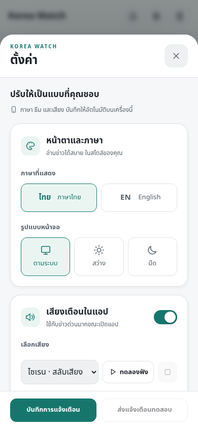
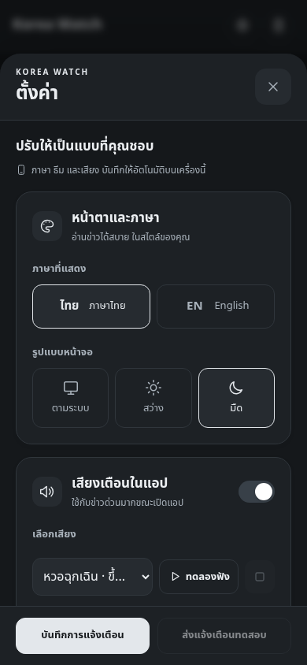

# Korea Watch — รุ่นปรับปรุงสำหรับ iMac

รุ่นภาษาทั้งระบบและปุ่มหน้าอ่านข่าว: ดู [ขั้นตอนอัปเดตล่าสุด](docs/system-language-update.md) ซึ่งต้อง deploy rules ก่อน Hosting และใช้ worker จาก branch ใหม่ด้วย

เริ่มที่ไฟล์นี้ คู่มือติดตั้งเดิมอธิบายโครงสร้างรุ่นก่อนและไม่ได้ครอบคลุม Anonymous Auth หรือ rules รุ่นใหม่

## รุ่นแก้การตั้งค่า แจ้งเตือน และข่าวหลายหมวด

- หน้าตั้งค่าเป็นขาว–ดำตามหน้าหลัก และมีปุ่มตั้งค่าเพียงปุ่มเดียว
- เพิ่มหวอฉุกเฉินแบบไล่เสียงยาวและไซเรนเร็ว รวมเป็น 7 เสียง พร้อมปรับระดับเสียง
- บันทึก subscription แบบ transaction เพื่อรักษา `lastTestAt` และคำขอทดสอบที่รอส่ง การเปิดรับแจ้งเตือนครั้งแรกจะเรียกแจ้งเตือนบนเครื่องและเข้าคิวทดสอบส่งจาก worker ไม่มีข้อความยืนยันว่าเครื่องรับอยู่โดยไม่ได้ทดสอบ
- คิวแปลหมุนเวียนตามหมวด ข่าวเกาหลีที่เข้าทางด่วนแล้วจะไม่ใช้ช่องแปลปกติทั้งหมด เพิ่มแหล่งค้นข่าวโลก สุขภาพ อาหาร น้ำมัน และค่าเงินตามหมวดเดิม
- ตรวจทั้งหัวข้อ สรุป และเนื้อหาว่าเป็นภาษาไทย ส่งข้อมูลเดิมที่แปลไม่ครบกลับเข้าคิว โดยไม่ส่งข่าวเดิมซ้ำ
- เลื่อนถึงท้ายหน้าเพื่อรีเฟรช feed จากเซิร์ฟเวอร์ มีปุ่มกดซ้ำและป้องกันการเรียกอัตโนมัติถี่กว่า 30 วินาที รีเฟรชไม่รีโหลดแอป และไม่สั่ง GitHub worker ให้เริ่มรอบใหม่

 

### ขั้นตอนอัปเดตรุ่นนี้

รุ่นนี้แก้ทั้งเว็บ, rules และ worker จึงอัปเดตเฉพาะ Hosting ไม่พอ ใช้โปรเจกต์ Firebase และ GitHub Secrets เดิมได้

1. ดาวน์โหลดโค้ด branch แก้ไขใหม่แล้วเปิด Terminal ที่โฟลเดอร์นั้น
2. ติดตั้งและตรวจ rules ด้วย JDK 21 ที่ตั้งไว้แล้ว:

```bash
cd worker
npm ci --no-audit --no-fund
npm run build:web
npm test
npm run test:rules
```

3. เมื่อผ่านแล้ว deploy rules ใหม่ก่อน แล้ว deploy เว็บ:

```bash
cd ..
./worker/node_modules/.bin/firebase deploy --project korea-watch01 --only firestore:rules
./worker/node_modules/.bin/firebase deploy --project korea-watch01 --only hosting
```

4. Merge branch ใหม่นี้เข้า `main` บน GitHub แล้วไป Actions → Fetch news → Run workflow → main การ deploy Firebase ไม่ได้อัปเดต worker บน GitHub ให้อัตโนมัติ
5. เปิดเว็บใหม่แล้วบันทึกการแจ้งเตือนหนึ่งครั้ง การทดสอบบนเครื่องเกิดหลังบันทึกสำเร็จ ส่วนคำขอทดสอบจากเซิร์ฟเวอร์จะถูกส่งในรอบ worker
6. หากหมวดข่าวยังไม่มา ให้ตรวจแบบอ่านอย่างเดียวจากโฟลเดอร์ `worker`:

```bash
npm run diagnose:translation
```

รายงานจะแสดง commit/branch ของ worker, อายุการอัปเดต, จำนวนข่าวแต่ละหมวด, คิวแปล และ error ของ AI โดยไม่ต้องใส่ service account เพิ่ม การกด Run workflow ด้วยตนเองจะลองช่องทาง AI ที่เคยถูกพักเพราะ credentials อีกครั้ง แต่ไม่รีเซ็ตโควตารายวัน

เสียงที่เลือกใช้เมื่อเปิดแอปอยู่ เสียง push ขณะปิดแอปขึ้นกับระบบปฏิบัติการและเบราว์เซอร์ ไม่เปลี่ยนตามตัวเลือกเสียงบนเว็บ และผลที่ FCM รับคำขอไม่ใช่หลักฐานว่าอุปกรณ์ส่งเสียงแล้ว

## 1. เตรียมเครื่อง

- ใช้ Node.js 24 LTS รุ่น 24.15 ขึ้นไป หรือ Node.js 25 รุ่น 25.9 ขึ้นไป (ทั้ง Apple Silicon และ Intel ใช้ได้ตามที่ Node/Playwright รองรับ)
- หากต้องทดสอบ Firestore rules ให้ติดตั้ง JDK 21 ด้วย
- ดาวน์โหลด Node จากเว็บไซต์ทางการ หรือใช้เครื่องมือจัดการเวอร์ชันที่มีอยู่
- แตก ZIP แล้วย้าย Terminal เข้าโฟลเดอร์ `korea-watch`

```bash
bash scripts/setup-mac.sh
```

สคริปต์ติดตั้งแพ็กเกจตาม lockfile, สร้าง Firebase SDK ภายในเว็บ, ติดตั้ง Chromium และรันทดสอบ ไม่เชื่อมฐานข้อมูลจริง ไม่ส่ง push และไม่ deploy

หากติดตั้งทีละขั้น:

```bash
cd worker
npm ci --no-audit --no-fund
npm run build:web
npx playwright install chromium
npm test
npm run test:rules
```

`npm test` ต้องมี Chromium จริง หากไม่มีจะรายงานล้มเหลว ไม่ข้ามแล้วอ้างว่าผ่าน ส่วน `npm run test:rules` ใช้ demo project และ emulator บนพอร์ต 8085 ไม่ใช้ฐานข้อมูล production

Node 25: เครื่องมือบางแพ็กเกจที่มากับ Firebase CLI ยังไม่ได้ระบุ Node 25 ใน engines และ npm อาจแสดง EBADENGINE warning แม้โค้ดแอปจะทำงานได้ หากเครื่องตั้ง engine-strict=true การติดตั้งอาจหยุดที่แพ็กเกจนี้ ควรใช้ Node 24 หรือวิเคราะห์ error ก่อน ไม่ต้องแก้ checksum หรือปิดการตรวจ TLS รายงานทดสอบระบุระบบที่ใช้จริงไว้ใน TEST-REPORT.md

## 2. เปิดหน้าเว็บในเครื่อง

```bash
cd worker
npm run serve
```

เปิดเบราว์เซอร์ที่ `http://localhost:8080` สำหรับพัฒนา เซิร์ฟเวอร์นี้ให้บริการไฟล์ static เท่านั้น การเปิดหน้าที่ใช้ Firebase config จริงยังอาจอ่านฐานข้อมูลจริงได้ ต้องใช้ rules รุ่นใหม่ก่อนเปิดฟังก์ชันลงทะเบียน

การทดสอบ push บน iPhone ต้องใช้ HTTPS และเปิดแอปจาก Home Screen บน iOS รุ่นที่รองรับ ส่วน localhost บน Mac เหมาะกับการพัฒนาเว็บ ไม่ใช่การทดสอบส่ง push ถึง iPhone

## 3. สิ่งที่ต้องตั้งใน Firebase ก่อนใช้การสมัครแจ้งเตือนรุ่นใหม่

1. Firebase Console → Authentication → Sign-in method → เปิด **Anonymous**
2. ตรวจ `public/firebase-config.js` ว่าเป็นโปรเจกต์และ Web Push VAPID key ที่ต้องการ
3. ทดสอบ rules ด้วย `npm run test:rules` ให้ผ่านก่อน deploy
4. Deploy rules และเว็บรุ่นนี้พร้อมกัน
5. ให้ผู้ใช้เดิมเปิดแอปใหม่ กดบันทึกการแจ้งเตือนอีกครั้ง และส่งทดสอบ

Subscriber รุ่นใหม่ใช้ Anonymous Auth UID เป็น document ID ผู้ใช้ไม่ต้องสมัครบัญชี แต่เจ้าของแต่ละ UID เท่านั้นที่แก้ข้อมูลของตนเองได้

**การย้ายข้อมูล:** worker รุ่นนี้ส่งเฉพาะ subscription ที่มี `subscriptionVersion: 2` เพื่อหยุดใช้รายการเดิมที่ไม่มีเจ้าของยืนยันแล้ว การย้ายแบบนี้ตั้งใจให้ผู้ใช้เดิมสมัครใหม่ จึงอาจมีช่วงหยุดรับแจ้งเตือนจนกว่าจะกดบันทึกอีกครั้ง อย่าลบรายการเดิมอัตโนมัติหากยังต้องการตรวจประวัติ

Anonymous Auth ช่วยเรื่องเจ้าของข้อมูล แต่ไม่ได้ป้องกันการสร้างบัญชี/ข้อมูลจำนวนมากทั้งหมด แนะนำเปิด App Check และติดตาม usage สำหรับเว็บที่เผยแพร่กว้าง หากต้องการป้องกัน abuse จริงจังให้ย้ายการสมัครและขอทดสอบไป endpoint ที่ตรวจ App Check และจำกัดความถี่ฝั่ง server

## 4. รัน worker จริงจาก iMac

**คำสั่งในส่วนนี้เขียน Firestore และส่งแจ้งเตือนจริง** ให้เริ่มจากโปรเจกต์ทดสอบของคุณก่อน

เก็บ service account JSON นอกโฟลเดอร์โปรเจกต์ จากนั้น:

```bash
cd worker
cp .env.example .env
```

แก้ `.env` โดยใส่ `FIREBASE_SERVICE_ACCOUNT_PATH` เป็น absolute path ของไฟล์ JSON และใส่ API key ของผู้ให้บริการ AI ที่จะใช้อย่างน้อยหนึ่งเจ้า ห้ามส่งไฟล์ `.env` หรือ private key ขึ้น GitHub

```bash
npm start
```

คำสั่งรัน **หนึ่งรอบแล้วจบ** ไม่ได้ตั้งเวลาบน iMac ให้อัตโนมัติ หากยังใช้ GitHub Actions ให้ใช้ workflow ที่ให้มา อย่ารัน worker บน Mac พร้อม workflow ของโปรเจกต์เดียวกัน เพราะยังไม่มี distributed lock ข้าม runner สองเครื่อง

คำสั่งที่ไม่เขียนฐานข้อมูล:

```bash
npm run dry-run
```

คำสั่งนี้ดึง RSS จริง ต้องมีอินเทอร์เน็ตและอาจพบ feed ที่ปฏิเสธการเข้าถึง ให้ตรวจรายการ errors และจำนวนข่าว ไม่ถือว่าได้ข่าว 0 รายการแล้วผ่าน

```bash
npm run agent
```

Agent จริงอ่านข้อมูล สร้างงานแก้ข่าว และอาจเปิด/อัปเดต GitHub Issue เมื่อกำหนด token/repository ใช้เฉพาะเมื่อคุณต้องการให้ตรวจ production แล้ว

## 5. สร้างเว็บและ deploy

ทุกครั้งที่แก้เว็บ/SDK ให้สร้างใหม่เพื่ออัปเดต offline manifest:

```bash
cd worker
npm run build:web
npm test
npm run test:rules
cd ..
./worker/node_modules/.bin/firebase login
./worker/node_modules/.bin/firebase deploy --project YOUR_PROJECT_ID --only firestore:rules,hosting
```

เปลี่ยน `YOUR_PROJECT_ID` เอง ไม่ควร deploy ไปโปรเจกต์จริงก่อนทดสอบ credentials, rules, อ่านข่าว และส่งแจ้งเตือนทดสอบให้ครบ Firebase web config เป็นข้อมูลเปิดเผยได้ แต่ service account และ AI key ต้องเป็นความลับ

GitHub Actions ที่มีอยู่ยังใช้ Secrets เดิมได้: `FIREBASE_SERVICE_ACCOUNT`, `GROQ_API_KEY`, `GEMINI_API_KEY` และ `APP_URL` ตามที่ใช้จริง GitHub `GITHUB_TOKEN` มีขอบเขตเฉพาะ workflow ไม่ควรคัดลอกมาใช้บน Mac

## โครงสร้างข้อมูลรุ่นนี้

- `meta/feed`: ข่าวที่เผยแพร่แล้ว และข่าวสงครามเกาหลีที่ให้ขึ้นก่อนแปลเต็ม
- `meta/pending`: ข่าวทั่วไปที่รอแปล อ่านได้เฉพาะ Admin SDK
- `meta/seen`, `meta/quota`: สถานะภายใน
- `fixJobs/{id}`: งานแก้ข้อมูลจาก agent ลบหลังบันทึกข่าวสำเร็จเท่านั้น
- `notificationEvents/{newsId}`: งานแจ้งเตือนที่บันทึกใน batch เดียวกับข่าว
- `notificationJobs/{id}`: ผู้รับที่รอส่งซ้ำและใบรับผลสำเร็จ อายุประมาณ 6 ชั่วโมง
- `subscribers/{uid}` และ `pushlog/{uid}`: ข้อมูลของเจ้าของ Anonymous Auth UID

Feed กับ pending มีขีดจำกัดขนาดทุกครั้งที่บันทึก ไม่ได้สัญญาว่าจะเก็บข่าวครบ 30 วันเสมอ จำนวนรวมสูงสุด 250 ข่าวและขนาดเอกสารอาจทำให้ข่าวเก่าหลุดก่อน

## ข้อจำกัดที่ควรรู้

- การส่งแจ้งเตือนเป็นแบบ retry ได้และลดส่งซ้ำด้วย receipt แต่ยังอาจซ้ำได้หาก FCM รับสำเร็จแล้วกระบวนการตายก่อนบันทึก receipt ใช้ tag เดิมเพื่อลดการแสดงซ้ำบนอุปกรณ์
- ไม่รับประกันว่า scheduler ของ GitHub จะเริ่มตรงทุก 5 นาที
- โควตา AI เป็นเพดานประมาณการภายใน ไม่ใช่ยอดคงเหลือทางการ ควรปรับตามบัญชีจริง `AI_QUOTA_TIMEZONE` ต้องตรงนโยบาย reset ที่เลือกใช้
- AI ยังอาจแปลผิด/จัดระดับความด่วนผิด การรวมข่าวคล้ายยังเป็น heuristic แม้เพิ่มการกันตัวเลขที่ต่างกันแล้ว ควรตรวจแหล่งข่าวต้นฉบับ โดยเฉพาะข่าวฉุกเฉิน
- เว็บรวม Firebase SDK ไว้ใน offline shell แล้ว แต่ push และการโหลดข่าวใหม่ต้องมีเครือข่าย การเปิดแบบออฟไลน์ต้องเคยโหลดและติดตั้ง service worker สำเร็จก่อน
- รายละเอียดข่าวยังอยู่ใน feed เดียว เหมาะกับระบบขนาดเล็ก หากผู้ใช้/ข่าวเพิ่มมาก ให้แยก feed ย่อกับรายละเอียดรายบทความ และวัด read/write/bandwidth ก่อนปรับสถาปัตยกรรม
- ยังไม่ได้ทดสอบ credentials จริง, production push หรือการใช้งานบน iMac เครื่องของคุณในคลาวด์นี้

ดู `TEST-REPORT.md` สำหรับผลทดสอบและรายการที่ยังต้องยืนยัน
